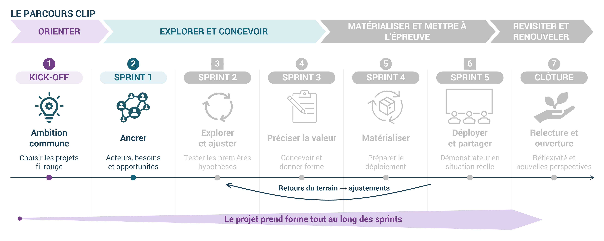

::: {.callout-note appearance="minimal"}
***Choisir un projet qui vous motive et que vous souhaitez faire avancer dans le cadre du CLIP-ASTERIE***

> ***Durée du sprint :** du 14 octobre au 18 novembre 2026.*
:::

## En bref

{fig-alt="Sprint 1 — Ancrer" width="100%"}

Lors de notre journée d’ateliers du 14 octobre, nous avons fait émerger trois ambitions communes, représentées par les dirigeables :

::: {.callout-important appearance="minimal"}
- **Le TLE autonome.**

- **Le TLE comme lieu ouvert.**

- **Le TLE vecteur de bien-être et de lien humain.**
:::

Ce premier sprint vous invite à relier ces ambitions à des projets concrets, en cours ou à venir dans votre TLE.

Les temps de travail du CLIP-ASTERIE vous permettront d’explorer ces projets, d’expérimenter des méthodes et des outils, puis de partager vos apprentissages. Appuyez-vous sur vos préoccupations et vos envies : **l’essentiel est de choisir un projet qui fait sens pour vous et votre TLE.**

## Les repères du sprint

Ce sprint comprend trois activités, dévoilées progressivement pour vous accompagner pas à pas.

- Découvrir Miro, identifier vos projets et choisir celui que vous souhaitez explorer.

- Lundi 26 octobre : ouverture de la deuxième activité. Un nouveau message vous guidera dans la suite du travail.

- La troisième activité sera présentée dans un second temps.

**Prévoyez environ 1 h 30 de travail autonome par semaine, dans le cadre du temps consacré au programme.**

## Votre espace de travail sur Miro

Toutes les activités du sprint se déroulent dans **un tableau Miro commun**. Chacune et chacun y dispose d’un espace personnel pour développer ses réflexions et documenter son projet.

::: {.callout-warning appearance="simple"}
## Activité 1

Prendre ses marques et choisir son projet. À réaliser cette semaine, avant l’ouverture de l’activité suivante le 26 octobre.

**Accéder au tableau Miro du Sprint 1 \[[cliquez ici](https://miro.com/app/board/uXjVEee1Elo=/?share_link_id=218643546910)\]**

Retrouvez votre espace et conservez-y vos contributions : vous les reprendrez et les enrichirez au fil des activités.
:::

::: {.callout-warning appearance="simple"}
## Activité 2

Dans votre TLE, vous mobilisez différentes compétences pour faire émerger des idées, accompagner les personnes, organiser l’action et concrétiser les projets. Cette activité vous propose un temps de réflexion individuelle sur votre manière de contribuer à un projet d’innovation.

### a. Réaliser votre auto-évaluation

Installez-vous au calme et répondez au questionnaire en vous appuyant sur vos expériences concrètes de direction de tiers-lieu et de conduite de projets.

Vos réponses reflètent la perception que vous avez aujourd’hui de vos compétences.

**Commencer mon auto-évaluation \[[cliquez ici](https://script.google.com/macros/s/AKfycbyCYjuk9IZKnaep-ZUl0F8gs0OF6JALDefxB0alEtORQZu5pxk27inAwcMAUqUjc6BeaQ/exec)\]**

À la fin du questionnaire, prenez le temps de lire vos résultats, puis **exportez-les à l’aide de la fonction proposée dans l’outil ou d'une capture d'écran**.

### b. Déposer vos résultats dans Miro

Retournez dans **le tableau Miro commun de l'activité 1**. Dans votre espace personnel, repérez la zone dédiée à l’activité 2 et importez l'image exporté. Le tableau a été mis à jour pour accueillir vos résultats.
:::

::: {.callout-warning appearance="simple"}
## Activité 3

Vous avez choisi un projet et exploré vos compétences. Cette troisième activité vous invite à porter différents regards sur ce projet grâce aux six chapeaux de Bono. 🎩

Chaque chapeau propose une manière de réfléchir : s’appuyer sur les faits, exprimer ses ressentis, repérer les difficultés, reconnaître les bénéfices, imaginer des possibilités et organiser la suite.

### **Rendez-vous** dans le tableau Miro :

1.  Retrouvez l’espace de l’activité 3 et suivez les consignes de chaque chapeau.

2.  Notez vos réflexions individuelles, une idée par post-it.

3.  Repérez les questions et les idées que vous souhaitez discuter lors du partage collectif.
:::

## Besoin d’un appui ?

L’équipe ERPI/ENSGSI vous accompagne tout au long du parcours. Signalez vos difficultés de prise en main de Miro et les questions rencontrées dans le choix ou la description de votre projet.

Contactez nous à l'adresse suivante : **ensgsi-clip-contact\@univ-lorraine.fr**