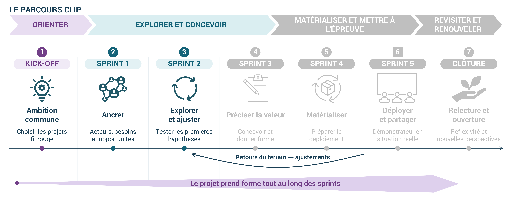

::: {.callout-note appearance="minimal"}
***Aller à la rencontre des personnes concernées par votre projet pour faire avancer sa conception, confronter vos premières idées au terrain et identifier les acteurs à mobiliser pour la suite.***

> ***Durée du sprint :** du 19 novembre au 6 janvier 2027.*
:::

## En bref

{fig-alt="Sprint 2 — Explorer et ajuster" width="100%"}

Au Sprint 1, vous avez choisi un projet lié à une ou plusieurs ambitions communes du réseau, pris du recul sur vos compétences et exploré votre projet avec les six chapeaux de Bono.

Ce sprint vous invite à passer à l’action en rencontrant les personnes concernées par votre projet. Vous préparerez un support simple à utiliser avec elles pour recueillir leurs réactions, tester vos premières hypothèses et faire émerger des pistes concrètes. Leurs retours, leurs ajouts et leurs désaccords vous aideront à ajuster votre projet et à mieux cibler les besoins auxquels il pourrait répondre.

::: {.callout-important appearance="minimal"}
**À la fin du sprint**, vous aurez avancé dans la définition de votre projet, documenté vos échanges, identifié les besoins prioritaires du terrain et repéré les acteurs à associer aux prochaines étapes.
:::

## Retour sur la session syncrhone {#retour-sur-la-session}

Retrouvez l'enregistrement du lancement du sprint 2 et les diapositives de notre invité.

### Lancement sprint 2

[Ouvrir le replay dans un nouvel onglet](https://univ-lorraine.scalelite.bbb.numerique-esr.fr/playback/presentation/2.3/85d724c0e87de93796c89089e719d58bad7947bc-1795093045149){.btn .btn-primary target="_blank" rel="noopener"}

```{=html}
<iframe
  src="https://univ-lorraine.scalelite.bbb.numerique-esr.fr/playback/presentation/2.3/85d724c0e87de93796c89089e719d58bad7947bc-1795093045149"
  title="Replay de la séance du Sprint 2"
  loading="lazy"
  allowfullscreen
  style="display: block; width: 100%; aspect-ratio: 16 / 9; border: 0;">
</iframe>
```
### Diapositives de l’intervention par Vincent Boly, Professeur émérite, ENSGSI-ERPI, Université de Lorraine

[Ouvrir les diapositives en PDF](../assets/documents/sprint-02-presentation.pdf){.btn .btn-outline-primary}

```{=html}
<iframe
  src="../assets/documents/sprint-02-presentation.pdf"
  title="Invité du Sprint 2 — Pourquoi est-il si difficile d'innover ensemble ? - Vincent Boly"
  loading="lazy"
  style="display: block; width: 100%; height: 65vh; border: 0;">
</iframe>
```

## Les repères du sprint

Trois activités vous accompagneront progressivement :

1.  **Matérialiser un support de discussion** à partir de votre projet.

2.  Échanger avec **3 à 5 acteurs**.

3.  **Synthétiser les besoins et cartographier les acteurs** à partir de vos retours.

Commencez par l’activité 1. Les consignes des deux activités suivantes sont mises à disposition au cas où vous souhaiteriez avancer à votre propre rythme.

**Prévoyez environ 1 h 30 de travail autonome par semaine, dans le cadre du temps consacré au programme.**

## Votre espace de travail sur Miro

Retrouvez votre espace dans le tableau commun du Sprint 2. Vous y déposerez le support préparé, les traces de vos échanges et votre synthèse.

**Accéder au tableau Miro du Sprint 2 \[[cliquez ici](https://miro.com/app/board/uXjVEee1Elo=/?share_link_id=218643546910)\]**

::: {.callout-warning appearance="simple"}
## Activité 1 - Matérialiser un support de discussion

Vous avez déjà un objectif ou une première piste de solution, nourrie par votre expérience et vos intuitions. Donnez-lui une forme simple pour pouvoir la présenter aux personnes concernées et **la faire évoluer avec elles**.

Choisissez **un seul support**, selon le degré de précision de votre idée et le temps que vous pouvez consacrer à sa préparation. L’effort indiqué concerne la préparation du support, sur une échelle de 1 (léger) à 3 (plus important).

| Support | Effort | Quand le choisir |
|:----------------------:|:----------------------:|:----------------------:|
| **Note d’intention** | **1** | Votre idée est encore ouverte. Posez l’objectif en quelques lignes et complétez la note avec un acteur clé pour préciser l’intérêt du projet et les contributions possibles. |
| **Flyer à compléter** | **1** | Vous pouvez résumer l’idée en une page. Invitez la personne à annoter, colorier ou compléter le flyer pour montrer ce qui lui paraît utile, peu clair ou manquant. |
| **Dépliant** | **2** | Plusieurs aspects de votre idée sont déjà définis. Présentez-les sur différents volets et demandez à la personne de les compléter ou de les réorganiser selon ses priorités. |
| **Boîte-produit (*Product Box*)** | **3** | Votre idée est assez concrète pour imaginer ce qu’elle offrirait et comment elle serait utilisée. Remplissez les faces de la boîte avec la personne, puis assemblez-la pour représenter ce qu’elle aimerait y trouver ou pouvoir faire grâce au projet. |

Avant la rencontre, préparez une première version et laissez des espaces à compléter. Pendant l’échange, invitez la personne à modifier le support avec vous. Gardez une trace de ce qu’elle ajoute, change ou remet en question pour préparer la prochaine version de votre idée.

Modèles à télécharger \[Lien — Note d’intention\] · \[Lien — Flyer à compléter\] · \[Lien — Dépliant\] · \[Lien — Boîte-produit à assembler\]
:::

::: {.callout-warning appearance="simple"}
## Activité 2 - Rencontrer les acteurs et recueillir leurs retours

Visez trois à cinq acteurs par projet. Commencez par une personne directement concernée par le besoin. Si possible, croisez ensuite son regard avec celui d’une autre personne concernée, d’un partenaire ou d’un relais du territoire.

Pendant l’échange, demandez à la personne de raconter une situation concrète, puis proposez-lui de compléter le support avec vou s. Que fait-elle aujourd’hui dans cette situation ? Qu’est-ce qui l’aide ou lui manque ? Que changerait-elle dans ce que vous lui proposez ?

Après chaque échange, déposez une courte trace dans Miro. Indiquez le rôle de la personne, ce qu’elle a dit ou ajouté au support, et ce que cela change dans votre compréhension du besoin. Vous pouvez joindre un extrait anonymisé du support complété, une photo légendée ou quelques lignes de synthèse.

**Accédez au tableau Miro du Sprint 2 pour charger la trace de vos échanges. \[[cliquez ici](https://miro.com/app/board/uXjVEee1Elo=/?share_link_id=218643546910)\]**
:::

## Le défi de Noël 🎄

**Ensemble, atteignons 100 points pour débloquer une surprise de Noël pour chaque TLE participant.**

Au kick-off, les trois dirigeables ont donné forme aux ambitions communes du réseau. Cette fois, ils voyagent ensemble : chaque support préparé et chaque rencontre documentée dans Miro les rapproche de leur destination.

::: {.callout-tip appearance="simple"}

### Objectif collectif : 100 points

À 100 points, une surprise de Noël sera dévoilée pour chaque TLE participant. Toutes les équipes alimentent le même compteur.

#### Suivez le voyage des dirigeables



:::

### Comment faire avancer les dirigeables ?

Déposez dans votre espace Miro les éléments suivants :

- **Votre support de discussion (issu de l'activité 1) — 5 points, une fois par projet.** Partagez une première version prête à être présentée et complétée avec un acteur.

- **Une trace par rencontre (activité 2) — 4 points, jusqu’à trois rencontres par projet.** Pour chaque échange avec un acteur différent, vous pouvez aussi joindre une trace (une photo légendée, ou un extrait anonymisé du support complété, etc.).

Toutes les contributions alimentent **un seul compteur, celui du réseau de TLE ASTÉRIE**.


::: {.callout-warning appearance="simple"}
## Activité 3 - Clarifier les besoins et cartographier les acteurs

À partir de ces retours, revenez sur Miro et utilisez la grille « Est / N’est pas / Fait / Ne fait pas » pour dessiner les contours de votre projet. Précisez ce qu’il est à ce stade, ce qui sort de son périmètre, ce qu’il devrait permettre aux personnes concernées de faire et ce qu’il ne prendrait pas en charge.

Toujours sur Miro, complétez ensuite votre cartographie d’acteurs. Situez les personnes et organisations concernées par le besoin, celles qui pourraient contribuer au projet et celles qu’il vous reste à rencontrer. Indiquez ce que vous souhaitez encore comprendre avec elles.

**Accédez au Miro pour finaliser le Sprint 2. \[[cliquez ici](https://miro.com/app/board/uXjVEee1Elo=/?share_link_id=218643546910)\]**
:::

## Besoin d’un appui ?

L’équipe ERPI/ENSGSI peut vous aider à choisir un support, à préparer un échange ou à relire vos premiers retours.

Contactez nous à l'adresse suivante : **ensgsi-clip-contact\@univ-lorraine.fr**