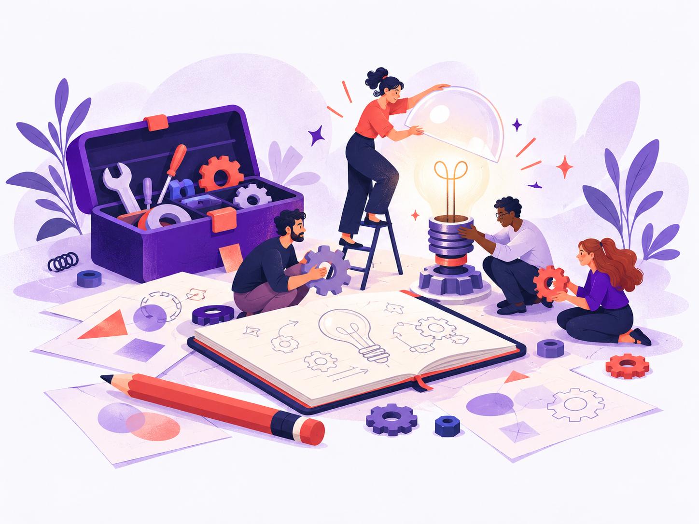

::::: {.resources-soon}

::: {.resources-art}

:::

:::: {.resources-copy}
[La boîte à outils du parcours]{.resources-label}

# Ça cogite en coulisses…

On rassemble les outils, on peaufine les modèles et on range les bonnes idées.

**Les premières ressources arrivent au fil des sprints.** Vous retrouverez bientôt ici des modèles, des outils et des lectures pour faire avancer votre tiers-lieu éducatif.

En attendant, les consignes et les supports déjà disponibles vous attendent sur les pages du parcours.

::: {.resources-actions}
[Explorer le parcours](../parcours/index.qmd){.btn .btn-primary}
[Nous écrire](mailto:ensgsi-clip-contact@univ-lorraine.fr){.btn .btn-outline-primary}
:::

Une ressource vous serait utile dès maintenant ? Faites-nous signe !
::::

:::::
